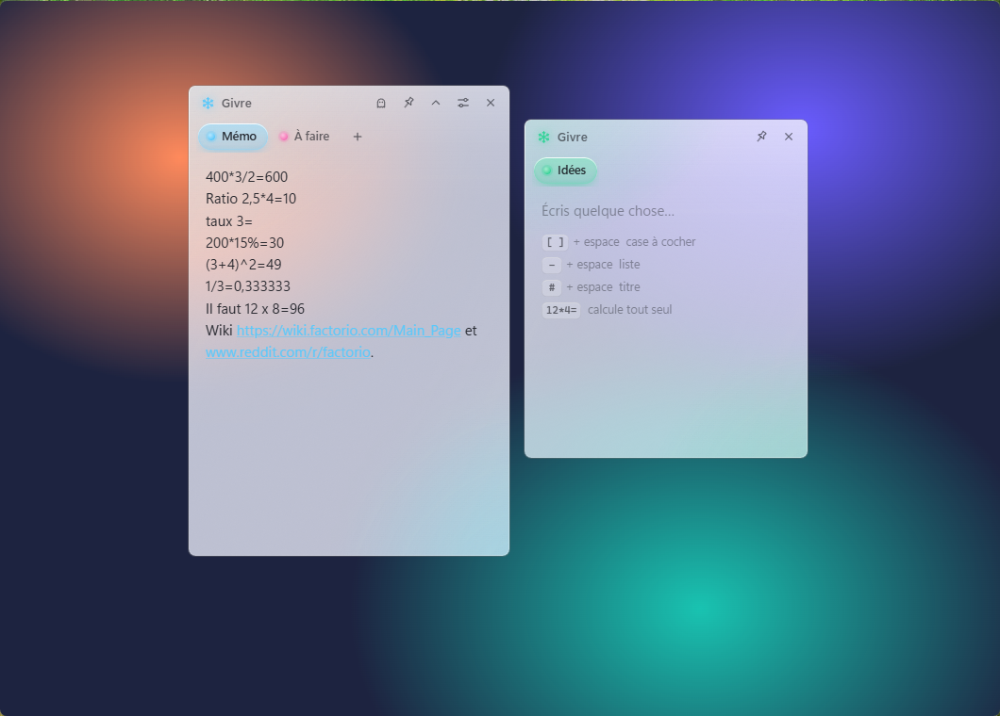

# 🧊 Givre

Aide-mémoire en verre givré, toujours au premier plan sur le bureau Windows 11.
Onglets colorés, cases à cocher, surligneur, images, calcul dans le texte, notes détachables,
mode fantôme pour écrire par-dessus un jeu… et partage de notes entre amis.



## Installer

1. Dans **[Releases](../../releases/latest)**, télécharge `Givre-windows.zip`.
2. Décompresse-le et lance **`Givre.exe`**.
   Windows peut afficher « Windows a protégé votre ordinateur » (l'app n'est pas signée) :
   clique sur **Informations complémentaires → Exécuter quand même**.
3. Clique sur **Installer** dans la notification (ou Réglages → Installation).
   Givre arrive dans le menu Démarrer et sur le Bureau, et le dossier décompressé peut être supprimé.

Pour désinstaller : Paramètres Windows → Applications installées → Givre. Les notes sont gardées,
sauf si tu coches « Supprimer aussi mes notes ».

Windows 11 uniquement (l'effet verre utilise l'acrylique de Windows 11).

## Ce qu'il sait faire

- **Verre** : le bureau est flouté derrière la note, même quand elle n'a pas le focus.
  Opacité, givrage, thème clair / sombre et taille du texte dans les Réglages.
- **Onglets** : double-clic pour renommer, clic droit pour la couleur (10 teintes ou une teinte libre),
  glisser pour réordonner, clic molette pour supprimer (avec Annuler).
- **Écrire vite** : en début de ligne, `[ ]` + espace → case à cocher, `-` + espace → liste,
  `#` + espace → titre. Gras, italique, barré, surligneur 5 couleurs.
- **Calcul** : tape `400*3/2=` et le résultat s'écrit tout seul (`Ctrl + Z` l'annule).
- **Liens** : les adresses `https://…` et `www.…` s'ouvrent au clic.
- **Images** : `Ctrl + V` d'une capture (`Win + Maj + S`) ou glisser une image ; clic pour l'agrandir.
- **Notes détachables** : tire un onglet vers le bas, il devient un pense-bête flottant.
  Glisse-le sur la barre d'onglets (ou clique sur ×) pour qu'il redevienne un onglet.
- **Épingler** (punaise en haut) : la note ne bouge plus.
- **Mode fantôme** (👻 ou `Ctrl + Alt + G`) : les clics traversent la note, idéal par-dessus un jeu.
- **Mode discret** : la note s'estompe quand la souris s'éloigne (« Opacité au repos » réglable).
- **Sauvegarde instantanée** dans `%APPDATA%\Givre`, avec une copie de secours.

## Partager une note

Clic droit sur l'onglet :

- **Copier pour partager** : un court message est copié. Envoie-le (Discord, message…) ;
  ton ami le copie puis fait `Ctrl + V` dans Givre, ou revient simplement sur Givre qui propose « Ajouter ».
  Texte seulement.
- **Partager en fichier…** : crée un fichier `.givre`, images comprises. Il suffit de l'ouvrir
  (double-clic) ou de le glisser sur Givre.

Les notes reçues sont nettoyées : seul le contenu que Givre sait produire est conservé.

## Raccourcis

| Raccourci | Action |
| --- | --- |
| `Ctrl + Alt + N` | Afficher / masquer Givre (modifiable dans les Réglages) |
| `Ctrl + Alt + G` | Mode fantôme |
| `Ctrl + T` / `Ctrl + W` | Nouvel onglet / supprimer l'onglet |
| `Ctrl + Tab`, `Ctrl + 1…9` | Changer d'onglet |
| `Ctrl + Entrée` | Cocher / décocher la ligne |
| `Ctrl + B`, `Ctrl + I`, `Ctrl + Maj + X` | Gras, italique, barré |
| `Ctrl + Maj + H` | Surligner |
| `Ctrl + ,` | Réglages |

## Développement

```bash
npm install
npx install-electron   # si Electron n'a pas été téléchargé par npm install
npm start              # lance Givre depuis les sources
npm run pack           # construit dist/Givre-win32-x64/Givre.exe
npm run icon           # régénère l'icône depuis assets/icon.svg
```

Electron 45 avec le fond acrylique natif de Windows 11. Le verre reste vivant même quand la
fenêtre n'a pas le focus grâce à `src/glass.js` (via koffi) : il renvoie `WM_NCACTIVATE` à chaque
perte de focus, sinon Windows remplace le flou par une couleur unie.
